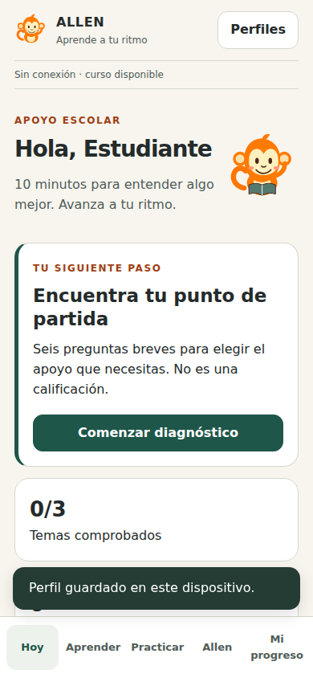
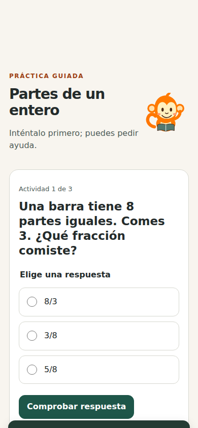
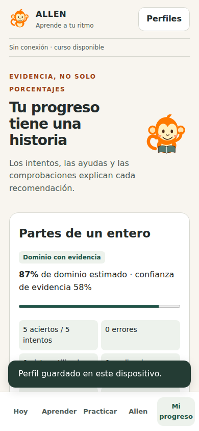

# Verificación de ALLEN móvil

Fecha: 10 de octubre de 2026. Entorno: Linux, Python 3.12, Node.js 24.19,
Playwright 1.55 y Chromium headless. Datos sintéticos, sin cuentas de estudiantes.

**Historia verificada:** el estudiante crea un perfil, realiza el diagnóstico,
aprende fracciones y responde ejercicios; el motor determinista guarda evidencia
en IndexedDB, recomienda el siguiente paso y permite continuar después de recargar
sin conexión usando el curso descargado por el service worker.

## Resultados

| Comprobación | Resultado | Evidencia |
| --- | --- | --- |
| Suite Python completa | 106 pruebas aprobadas | `python -m pytest -q` · incluye escritorio, móvil y paridad |
| Suite JavaScript completa | 39 pruebas aprobadas | `node --test tests/*.mjs` |
| Paridad de dominio y recomendaciones | Aprobada | 103 estados comparados entre Python y JavaScript |
| Interfaz → motor | Aprobada | Diagnóstico de seis preguntas, pistas y comprobaciones de los tres temas |
| Motor → almacenamiento | Aprobada | Lectura de IndexedDB confirma respuestas, ayudas y temas completados |
| Almacenamiento → interfaz | Aprobada | Sesión recuperada después de recarga sin conexión |
| Cache offline | Aprobada | Navegador sin conexión completa los tres temas y repasa tarjetas |
| Perfiles y recuperación | Aprobada | Perfil nuevo sin evidencia ajena; recuperación crea otra identidad y conserva datos anteriores |
| Copias no confiables | Aprobada | Texto con markup se muestra como texto; privilegios comerciales se descartan |
| Conflicto entre pestañas | Aprobada | Escritura antigua rechazada sin sobrescribir progreso reciente |
| Falta de espacio | Aprobada | Error simulado de IndexedDB mantiene el progreso anterior y muestra aviso |
| CSP y tráfico | Aprobada | Prueba con headers actuales de producción; sin errores de consola ni solicitudes a servicios externos |
| Navegación y tamaño | Aprobada | Sin desbordamiento horizontal en 320, 360, 390, 768 y 1366 px |
| Ruff, checks del repositorio | Aprobados | `ruff check backend tools distribution tests --select E9,F63,F7,F82` |
| Bandit | Sin hallazgos de severidad media/alta | Checks existentes `bandit -r backend tools distribution -ll -q` |
| Dependencias Python | Sin vulnerabilidades conocidas reportadas | `pip_audit -r requirements.txt`, ejecutado en esta fecha |
| Whitespace del cambio | Aprobado | `git diff --check` |

La suite Python emite un aviso de deprecación de la integración de TestClient con
httpx en Starlette. No es una falla de las pruebas y no se cambió esa integración
en esta entrega.

## Capturas

Capturas a 390 × 844 px con un perfil sintético. Los avisos temporales se ocultaron
solo en la captura para mostrar la interfaz. El estado de conectividad es real:
el contexto del navegador estaba offline después de descargar el curso.

| Hoy | Práctica | Progreso |
| --- | --- | --- |
|  |  |  |

## Límites de la verificación

- No se ejecutó un emulador ni un teléfono Android físico. Instalación real,
  comportamiento al suspender la app, almacenamiento bajo presión, accesibilidad
  con lector de pantalla y compatibilidad de dispositivos siguen pendientes.
- No se construyó APK ni AAB. La entrega es una PWA, no una app nativa validada.
- IA generativa local/remota y pagos no están activos; no se afirma haberlos probado.
- No hay sincronización con SQLite de escritorio ni importación de cursos docentes
  en móvil. Teacher Studio conserva su prueba de escritorio.
- Las pruebas confirman funcionamiento y consistencia técnica; no demuestran
  eficacia pedagógica. Los temas requieren revisión docente y pruebas con usuarios.
- No se hizo despliegue comercial. La ejecución probada fue local.

## Revisión y próximos pasos

Antes de publicar: probar la instalación HTTPS en Android físico, revisar contenido
con docentes, validar recuperación al cambiar de dispositivo y observar si los
estudiantes comprenden mejor después de las sesiones. Después ampliar el catálogo
con el mismo estándar de revisión y estudiar la integración de IA y compras.
